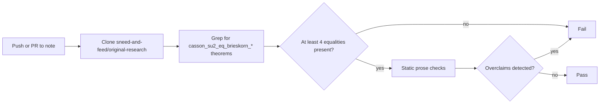

# Formation Sketch Checker

**Automated guardrails** that keep the Seifert–Brieskorn / 2-adic spectral circle formation sketch honest against the machine-checked Lean sources.

## How it works

1. On every change to the note, the workflow clones the live Lean formalization.
2. It verifies that the four certified Casson equality theorems still exist.
3. It scans the markdown for the previously corrected overclaims (topological sphere, filling circles, constant step weight, unscoped Haar/Lyapunov, mismatched Casson rows).
4. The build fails if any check fails, so the prose cannot drift.

## What it protects against

- Unscoped claim that a 3-variable Brieskorn link is a topological sphere
- Spectrum described as filling circles (eigenvalues lie *on* the circles)
- Constant per-step weight magnitude √2 (it is the product around the cycle)
- Haar uniqueness or Lyapunov exponent stated as fact
- Mismatched Casson rows (Σ(3,4,5), Σ(3,5,7)) marked as agreeing

## Certified facts (live-checked)

- Pairwise coprimality ⇒ integral homology 3-sphere (via |O| = 1)
- Casson equality holds with `rfl` only for Σ(2,3,5), Σ(2,3,7), Σ(2,3,11), Σ(2,5,7)
- Eigenvalues of the finite Collatz relation matrix lie on the circles of radius 2^{2^{-(m-1)}}

## Open edges

See [formation_sketch_seifert_spectral.md](formation_sketch_seifert_spectral.md). The graph criterion contributes nothing topological in three variables. Haar/Gibbs uniqueness and the Lyapunov exponent remain unformalized.

## Next steps

- Add a Lean build step that re-checks the four equality theorems.
- Surface the (3,4,5)/(3,5,7) mismatch as a tracked issue.
